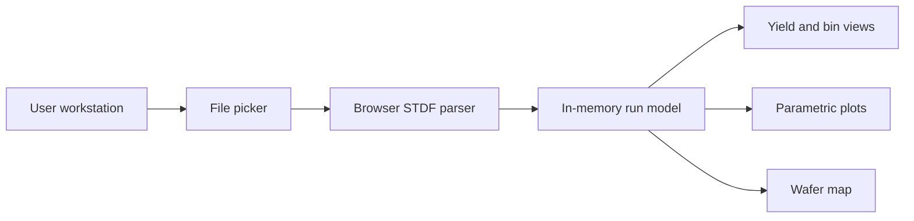

# Architecture

## Current data flow



STDF bytes remain in the browser process. The web server supplies HTML, JavaScript, CSS, and static assets but does not receive the selected file in version 0.1.0.

## Main components

| Component | Location | Responsibility |
|---|---|---|
| Application UI | `app/page.tsx` | Navigation, cancellable loading state, plots and maps |
| STDF parser | `app/lib/stdf.ts`, `app/lib/model.ts` | Local decompression, record decoding and normalized run types |
| Statistics | `app/lib/statistics.ts` | Existing statistical definitions and safe extrema |
| Visual system | `app/globals.css` | Professional light-theme layout and responsive behavior |
| Metadata | `app/layout.tsx` | Page title and social metadata |
| Sites adapter | `vite.config.ts`, `worker/` | Vinext and Cloudflare-compatible build output |
| Optional database skeleton | `db/`, `drizzle.config.ts` | Reserved for future persistent state |
| Local container | `Dockerfile`, `docker-compose.yml` | On-premise or local production server |

## Trust boundaries

1. **Customer file boundary:** untrusted binary data enters the browser parser.
2. **Browser memory boundary:** parsed results and UI state share the same origin.
3. **Static server boundary:** the server should not receive STDF, but it must still be patched and access-controlled.
4. **Repository boundary:** source and build context must never include customer STDF.

## Recommended production evolution

### Parser worker

Record parsing currently yields cooperatively and gzip uses an asynchronous worker. A future separate parser worker should move all record decoding from the main UI thread. Stream records, enforce byte/record/time limits, and return typed batches so a malformed or large file cannot freeze the interface.

### Analytics domain layer

Separate parsing, normalization, calculation, and visualization:

```text
binary input -> record decoder -> normalized run -> calculation engine -> views/reports
```

This enables conformance tests, versioned calculation rules, and auditability.

### Optional persistent deployment

For enterprise customers, add an explicit on-premises backend with:

- authenticated users and roles;
- encrypted object storage;
- normalized analytical database;
- job queue and workers;
- audit history and retention rules;
- signed/exported reports;
- backup and restore procedures.

Do not silently change from local-only processing to server upload. Make the deployment mode and data flow visible to the customer and reflect it in contracts and privacy materials.

